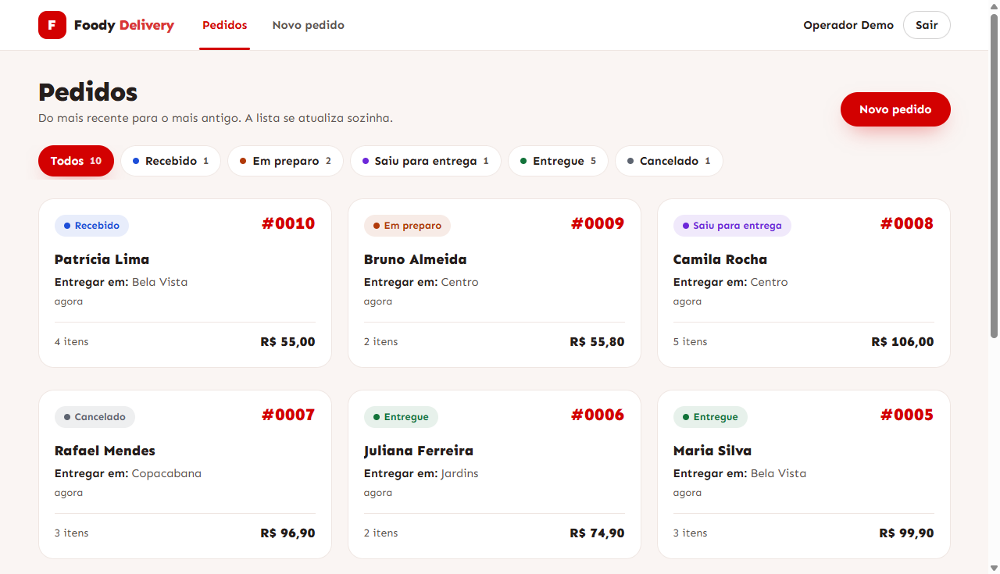
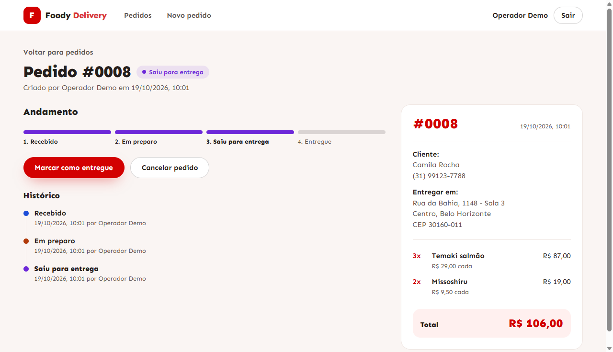
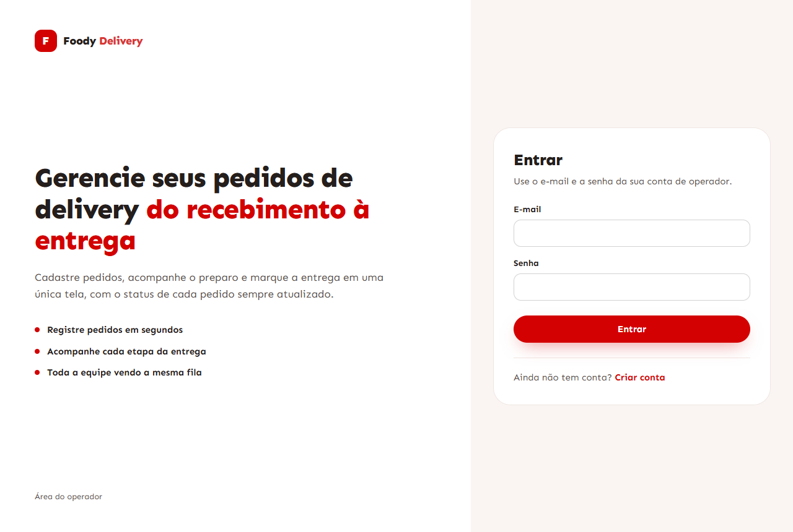
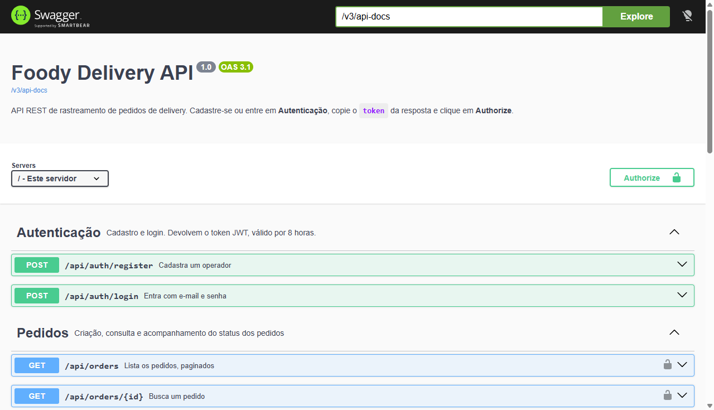
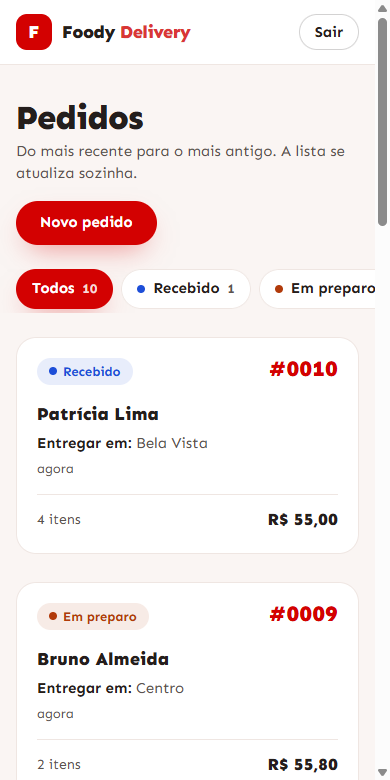
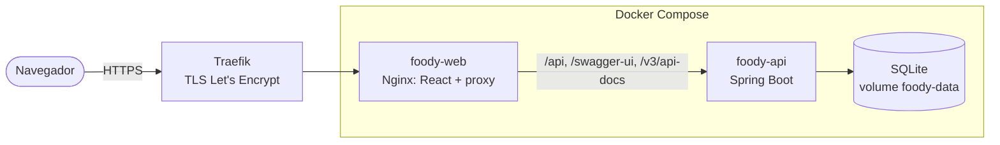
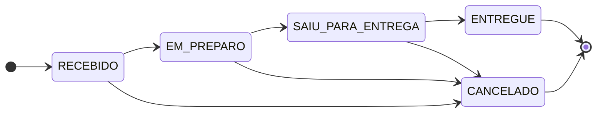

# Foody Delivery

Sistema de rastreamento de pedidos de delivery: operadores autenticados cadastram pedidos, acompanham a fila com o status de cada um e levam cada pedido do recebimento à entrega, com a linha do tempo de quem fez cada mudança.

    

## Demonstração

| | |
|---|---|
| **Aplicação** | https://foody.cardap.live |
| **Conta de demonstração** | `demo@cardap.live` / `demo1234` (ou crie a sua em "Criar conta") |
| **Documentação interativa da API** | https://foody.cardap.live/swagger-ui.html |

A demonstração é compartilhada: os pedidos que você criar ficam visíveis para quem entrar depois.

| Fila de pedidos | Pedido com linha do tempo |
|---|---|
|  |  |
| **Entrada** | **API documentada (Swagger UI)** |
|  |  |

<p align="center"></p>

---

## O que foi pedido e onde está

| Requisito do desafio | Onde foi atendido |
|---|---|
| API REST em Spring Boot | [`backend/`](backend): Spring Boot 4.0, Java 21 |
| Cadastro e login de usuários | `POST /api/auth/register` e `/login`, JWT HS256 com senha em BCrypt ([`AuthService`](backend/src/main/java/com/foody/delivery/service/AuthService.java)) |
| Criar pedido com cliente, itens e endereço | `POST /api/orders`, com validação de cada campo e `Location` na resposta |
| Atualizar status (`RECEBIDO`, `EM_PREPARO`, `SAIU_PARA_ENTREGA`, `ENTREGUE`, `CANCELADO`) | `PATCH /api/orders/{id}/status`; as regras de transição ficam no domínio ([`OrderStatus`](backend/src/main/java/com/foody/delivery/model/OrderStatus.java)) |
| Listar pedidos e buscar por id | `GET /api/orders` (paginado e filtrável) e `GET /api/orders/{id}` |
| Banco SQLite | SQLite com esquema versionado pelo Flyway ([`db/migration`](backend/src/main/resources/db/migration)) |
| Front-end em React que lista pedidos com status e cria pedidos | [`frontend/`](frontend): React 19 + TypeScript |
| Histórico no Git | commits pequenos, um por etapa |

**Além do pedido:** linha do tempo de status com autor e horário; paginação, filtro e contagem por status; documentação interativa (OpenAPI); health check, métricas e id de correlação por requisição; testes com 100% de cobertura no back-end; acessibilidade verificada (axe-core e Lighthouse); Docker com deploy em VPS sob HTTPS; coleção Postman/Newman com 86 asserções.

---

## Arquitetura



- O navegador fala só com o Nginx. Front e API ficam na **mesma origem**, então não há CORS em produção.
- A API não é publicada para fora: só o Nginx a alcança, pela rede interna do Docker. O `/actuator` (health check e métricas) também não é repassado.
- No servidor, o Traefik (já existente, compartilhado com outros sites) termina o HTTPS e encaminha pelo domínio. O override [`docker-compose.prod.yml`](docker-compose.prod.yml) só acrescenta as labels do Traefik.

**Back-end em camadas (MVC):** `controller → service → repository → model`. As regras de negócio ficam nas entidades (`Order.changeStatus`, `OrderStatus.canTransitionTo`, total calculado), e o service só orquestra a transação e converte para DTO.

**Front-end por funcionalidade:** `features/auth` e `features/orders`, com uma camada `shared` (HTTP, componentes, formatação) que não conhece nenhuma delas.

### Fluxo de status



Todo pedido nasce `RECEBIDO`, definido pelo servidor. Só é possível avançar um passo ou cancelar; `ENTREGUE` e `CANCELADO` são finais. Qualquer outra transição responde `422` e não entra no histórico.

---

## Rodando

### Tudo com Docker (recomendado)

```bash
cp .env.example .env                  # defina JWT_SECRET (openssl rand -base64 48)
docker compose up -d --build --wait   # http://localhost, retorna quando tudo está saudável
docker compose logs -f foody-api      # logs da API
```

- Documentação da API em http://localhost/swagger-ui.html.
- O compose **não sobe sem `JWT_SECRET`**, para não rodar em produção com a chave de desenvolvimento.
- O banco fica no volume `foody-data` e sobrevive a rebuilds. O `foody-web` só sobe depois que o health check da API responde `UP`.
- Imagens em dois estágios; a API roda com usuário sem privilégios. Outra porta: `WEB_PORT=8081` no `.env`.

### Deploy em VPS

1. Instale o Docker (`curl -fsSL https://get.docker.com | sh`), clone o repositório e crie o `.env` com `JWT_SECRET`.
2. Sozinho no servidor: `docker compose up -d --build --wait` (porta 80).
3. Atrás do Traefik, como em https://foody.cardap.live: acrescente `APP_DOMAIN=seu.dominio` ao `.env` e rode `docker compose -f docker-compose.yml -f docker-compose.prod.yml up -d --build --wait`.

Atualizações: `git pull` e o mesmo comando. As migrações do Flyway rodam na subida da API.

### Sem Docker

```bash
cd backend && ./mvnw spring-boot:run     # API em :8080 (Windows: mvnw.cmd), requer JDK 21+
cd frontend && npm install && npm run dev  # front em :5173, requer Node.js 20+; o Vite repassa /api
```

| Variável | Padrão | Descrição |
|---|---|---|
| `JWT_SECRET` | chave de desenvolvimento | Chave HS256 em Base64, mínimo 32 bytes. **Defina em produção.** |
| `APP_DOMAIN` | — | Só no deploy com Traefik: o domínio da aplicação |

---

## Qualidade e testes

| O que | Como rodar | Resultado |
|---|---|---|
| Back-end: unitários e integração (MockMvc + SQLite criado pelas migrações) | `cd backend && ./mvnw verify` | 165 testes; **o build falha abaixo de 100%** de linhas ou branches (JaCoCo) |
| Front-end: fluxos com a API simulada (MSW) e acessibilidade (axe-core, WCAG 2.1 AA) | `cd frontend && npm test` | 103 testes |
| API de ponta a ponta (Postman/Newman) | ver abaixo | 24 requisições, 86 asserções |
| Lighthouse (login e cadastro) | `npx lighthouse https://foody.cardap.live/login` | Acessibilidade 100, Boas práticas 100, SEO 100 |

```bash
# Newman contra a API local (:8080), o Docker (http://localhost) ou a demonstração
npx newman run postman/foody-delivery.postman_collection.json -e postman/local.postman_environment.json
npx newman run postman/foody-delivery.postman_collection.json -e postman/local.postman_environment.json --env-var baseUrl=https://foody.cardap.live
```

**Acessibilidade:** além dos testes automáticos em cada tela, as telas logadas foram auditadas com axe-core num navegador real, contraste incluído: lista, filtro ativo, formulário com erros, detalhe e confirmação de cancelamento ficaram sem nenhuma violação. A auditoria encontrou dois problemas de contraste, já corrigidos: o "Delivery" do logotipo (3,0:1) e as etiquetas de status (4,4:1). Os tons foram escurecidos para pelo menos 4,6:1 e 5:1.

---

## API

A documentação completa e executável está no **Swagger UI** (`/swagger-ui.html`): cadastre-se em *Autenticação*, copie o `token` e clique em **Authorize**. O documento OpenAPI fica em `/v3/api-docs`.

| Método | Rota | Descrição | Sucesso |
|---|---|---|---|
| `POST` | `/api/auth/register` | Cadastra operador (`name`, `email`, `password`) e já devolve o token | `201` |
| `POST` | `/api/auth/login` | Login com `email` e `password` | `200` |
| `POST` | `/api/orders` | Cria pedido (cliente, endereço, itens); nasce `RECEBIDO` | `201` + `Location` |
| `GET` | `/api/orders?status=&page=0&size=20` | Página de pedidos, mais recentes primeiro, opcionalmente de um status | `200` |
| `GET` | `/api/orders/status-count` | Quantidade de pedidos em cada status, inclusive os com zero | `200` |
| `GET` | `/api/orders/{id}` | Pedido com itens, total e linha do tempo (`statusHistory`) | `200` |
| `PATCH` | `/api/orders/{id}/status` | Muda o status (`{"status": "EM_PREPARO"}`) e registra quem mudou | `200` |

Rotas de pedidos exigem `Authorization: Bearer <token>`.

<details>
<summary>Exemplo com curl</summary>

```bash
BASE=http://localhost   # ou https://foody.cardap.live

TOKEN=$(curl -s -X POST $BASE/api/auth/login -H "Content-Type: application/json" \
  -d '{"email": "demo@cardap.live", "password": "demo1234"}' | sed -E 's/.*"token":"([^"]+)".*/\1/')

curl -X POST $BASE/api/orders -H "Content-Type: application/json" -H "Authorization: Bearer $TOKEN" -d '{
  "customerName": "Maria Silva",
  "customerPhone": "(11) 99999-8888",
  "deliveryAddress": { "street": "Av. Paulista", "number": "1000", "complement": "Apto 12",
                       "neighborhood": "Bela Vista", "city": "Sao Paulo", "zipCode": "01310-100" },
  "items": [ { "name": "Pizza Margherita", "quantity": 2, "unitPrice": 45.00 },
             { "name": "Refrigerante", "quantity": 1, "unitPrice": 9.90 } ]
}'

curl -X PATCH $BASE/api/orders/1/status -H "Content-Type: application/json" -H "Authorization: Bearer $TOKEN" \
  -d '{"status": "EM_PREPARO"}'

curl "$BASE/api/orders?status=EM_PREPARO&size=5" -H "Authorization: Bearer $TOKEN"
```

No Windows, acentos digitados no terminal podem não sair em UTF-8 e a API responde `400`. Nesse caso, salve o JSON num arquivo UTF-8 e envie com `--data-binary @pedido.json`.
</details>

### Formato de erro

Todos os erros têm o mesmo formato; `fieldErrors` aponta cada campo inválido (inclusive `items[0].quantity` e parâmetros como `size`).

```json
{
  "status": 400,
  "error": "Bad Request",
  "message": "Dados inválidos",
  "fieldErrors": [{ "field": "items", "message": "O pedido deve ter ao menos um item" }],
  "timestamp": "2026-10-19T13:00:00Z"
}
```

| Situação | HTTP |
|---|---|
| Validação, JSON inválido, status desconhecido (a resposta lista os aceitos), página fora dos limites | `400` |
| Sem token, token inválido ou expirado, credenciais inválidas | `401` |
| Pedido ou rota inexistente | `404` |
| E-mail já cadastrado | `409` |
| Transição de status não permitida | `422` |
| Erro inesperado (sem detalhes internos) | `500` |

---

## Banco de dados e migrações

O esquema pertence às migrações do **Flyway** ([`db/migration`](backend/src/main/resources/db/migration)); o Hibernate só **valida** que as entidades batem com ele (`ddl-auto: validate`).

| Versão | O que faz |
|---|---|
| `V1` | Esquema inicial (usuários, pedidos, itens), idêntico ao que o Hibernate gerava antes do Flyway |
| `V2` | Tabela `order_status_history` e índices da listagem (status + data) |
| `V3` | Reconstrói o histórico dos pedidos antigos: a criação (com autor) e o status atual (sem autor, que não foi registrado na época) |

Bancos criados antes do Flyway, como o da demonstração, são adotados por **baseline** na versão 1, sem recriar nada, e recebem só V2 e V3. Antes de migrar a produção, foi feito backup do banco. O mesmo caminho foi ensaiado antes numa cópia de um banco antigo. Os testes rodam sobre um banco em memória criado pelas mesmas migrações, um por contexto do Spring.

## Observabilidade

- **Health check:** `/actuator/health` (inclui o banco), usado pelo `docker compose` para só liberar o front com a API pronta. `/actuator/info` mostra versão e horário do build; `/actuator/metrics` exige token.
- **Id de correlação:** cada requisição ganha um `X-Request-Id`, gerado pelo Nginx e devolvido na resposta. Ele aparece no log de acesso do Nginx e em **todas** as linhas de log da API daquela requisição (MDC), o que permite rastrear um erro do navegador até o log.
- **Log de acesso da API:** método, rota, status e duração de cada chamada (`PATCH /api/orders/7/status -> 422 (4 ms)`). Os logs de negócio (cadastro, login, pedido criado, mudança de status) nunca incluem senha, token ou dados pessoais do cliente.

```bash
docker compose logs foody-api | grep <X-Request-Id>
```

---

## Decisões e trade-offs

| Decisão | Por quê | Custo assumido |
|---|---|---|
| SQLite com pool de **1 conexão** | É o banco pedido; o SQLite não tem escrita concorrente, e uma conexão evita `database is locked` | Escritas em fila. Para muitos operadores simultâneos, o caminho é PostgreSQL (o Flyway e o JPA já isolam essa troca) |
| **JWT stateless** de 8 h, sem refresh token | Simples, sem sessão no servidor | Não dá para revogar um token antes de expirar; o próximo passo seria refresh token com rotação |
| Histórico como **tabela própria**, gravado pelo domínio | `Order.changeStatus` é o único caminho para mudar status, então o histórico nunca fica de fora | Uma linha a mais por mudança; os pedidos antigos têm o histórico reconstruído (V3) sem o autor das mudanças intermediárias |
| Paginação com **contrato próprio** (`PageResponse`) | O JSON do `Page` do Spring Data não é estável entre versões | Uma classe a mais |
| Coleções em lote (`default_batch_fetch_size`) em vez de `join fetch` | `join fetch` de coleção com paginação faz o Hibernate paginar em memória | Três consultas por página (pedidos com o criador, todos os itens, todo o histórico), seja qual for o número de pedidos, em vez de uma só |
| Contagem por status em **endpoint separado** | Os filtros mostram números da base inteira, não só da página carregada | Uma requisição a mais na tela de lista (com cache e atualização a cada 15 s) |
| Filtro e página **na URL** (`?status=ENTREGUE&pagina=2`) | O botão voltar funciona e o link pode ser compartilhado | Valores inválidos na URL precisam ser tratados (caem no padrão) |
| Regras de negócio **no domínio** | Testáveis sem Spring; o service fica fino | — |
| MapStruct com `unmappedTargetPolicy = ERROR` | Mapeamento gerado em compilação; um campo esquecido quebra o build em vez de virar `null` | — |
| Ids `INTEGER` no banco e `Long` no Java | No SQLite, só `INTEGER PRIMARY KEY` é autoincremento (alias do rowid) | Anotação explícita (`@JdbcTypeCode`) para o Hibernate validar |
| Lombok com moderação | `@Getter`, construtor protegido e `@Slf4j`; sem `@Data` nem setters (o status só muda por `changeStatus`) | Construtores escritos à mão: o Lombok do VS Code (JDT) gera para eles código que o editor rejeita |

Outras escolhas: DTOs como `record` (a API nunca expõe entidades nem a senha); textos da API centralizados em `Messages` e reaproveitados pelos testes; normalização na entrada (e-mail em minúsculas, CEP e telefone só com dígitos); endereço como `@Embeddable`.

### Estrutura

```
backend/src/main/java/com/foody/delivery
├── config/         SecurityConfig, OpenApiConfig, ClockConfig
├── controller/     AuthController, OrderController
├── service/        AuthService, OrderService, JwtService
├── repository/     UserRepository, OrderRepository, StatusCount
├── model/          User, Order, OrderItem, OrderStatusChange, Address, OrderStatus
├── dto/            request/ e response/ (records, incluindo PageResponse)
├── mapper/         OrderMapper, UserMapper (MapStruct)
├── security/       JwtAuthenticationFilter, JwtAuthenticationEntryPoint
├── observability/  RequestIdFilter
├── exception/      GlobalExceptionHandler, ApiException e subclasses
├── validation/     @MaxBytes (limite de 72 bytes do BCrypt)
└── util/           Messages

frontend/src
├── app/            rotas, providers, layout autenticado
├── features/auth/  login, cadastro, sessão
├── features/orders/ api, hooks (TanStack Query), status, páginas e componentes
├── shared/         cliente HTTP, erros da API, componentes, máscaras e formatação
└── test/           MSW (API simulada), dados de teste e testes de acessibilidade
```

---

## Front-end

| Rota | Tela |
|---|---|
| `/login`, `/cadastro` | Entrar e criar conta (entra direto após o cadastro) |
| `/pedidos` | Fila em comandas, 12 por página, com contagem por status que também filtra; atualiza sozinha a cada 15 s |
| `/pedidos/novo` | Formulário com itens dinâmicos ao lado de uma comanda que se monta enquanto se digita |
| `/pedidos/:id` | Comanda completa, etapas, ações possíveis (cancelar pede confirmação) e histórico com autor e horário |

- **Dados do servidor com TanStack Query:** cache, carregamento e erro. Depois de criar um pedido ou mudar um status, a lista e as contagens são invalidadas. Ao trocar de página, a anterior fica na tela até a nova chegar.
- **Mesmas regras do back-end no formulário (Zod).** Os erros de campo da API (`items[0].quantity`, `deliveryAddress.zipCode`) caem no campo certo.
- **Fluxo de status espelhado** em `features/orders/status.ts`. Se outra pessoa mudou o pedido antes (`422`), a tela recarrega e explica o que aconteceu.
- **Entrada protegida:** telefone, CEP, quantidade e preço têm máscara, e nenhuma letra entra nesses campos.
- **Sessão:** qualquer `401` encerra a sessão e volta ao login com aviso. Ao sair, o cache é limpo.
- **Identidade visual da Foody Delivery:** fonte Sen, vermelho da marca, fundo bege quente, botões em pílula. Status sempre com cor e texto, foco de teclado visível e movimento reduzido respeitado.

## Próximos passos

- CI no GitHub Actions rodando `mvn verify`, `npm test` e Newman a cada push.
- Lock otimista (`@Version`) para responder `409` quando dois operadores mudarem o mesmo pedido ao mesmo tempo.
- Refresh token com rotação.
- Testes de ponta a ponta no navegador (Playwright).
